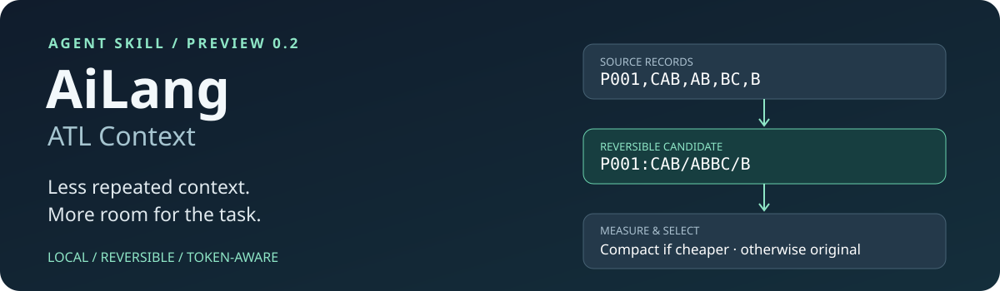

# AiLang — ATL Context



**Less repeated context. More room for the task.**

An experimental Agent Skill that finds compact, reversible input representations for LLM workflows — and keeps the original whenever compression is not worthwhile.

[Install](#install) · [Try it](#try-it) · [Evidence](#what-we-have-measured) · [Research](RESEARCH.md) · [Русский](README.ru.md)

> **Preview v0.2.0** · Local Node.js CLI · No API key · No automatic network calls

## Why AiLang?

LLM workflows frequently repeat the same source material or express structured operations in unnecessarily verbose prose. ATL Context compares equivalent representations using a verified tokenizer, preserving information rather than summarizing it away.

- **Adaptive:** compares flat JSON, grouped JSON, tuples and readable lines for independent task batches.
- **Typed:** supports compact, reversible notation for explicit sequences of swaps.
- **Conservative:** validates roundtrips and selects a compact format only when the modeled input token cost is strictly lower than its control.
- **Transparent:** static input counts are separate from provider billing, accuracy and latency. No claims about controlling hidden thoughts.

## Install

For Codex, from the project where you want the skill (Git and Node.js 18+):

```sh
src=$(mktemp -d)
git clone --depth 1 https://github.com/AlexandrKotelnikov/AILang.git "$src/AILang"
mkdir -p .agents/skills
test ! -e .agents/skills/atl-context && cp -R "$src/AILang/skills/atl-context" .agents/skills/
```

Start a new Codex session and invoke `$atl-context` explicitly. The copy command deliberately refuses to overwrite an existing skill. For a global install use `~/.agents/skills/`; for Claude Code the documented project folder is `.claude/skills/`. These paths follow [OpenAI's installation guidance](https://developers.openai.com/api/reference/cli); host integration has not yet been tested by this project. See [installation and updating](docs/INSTALL.md) for the local rank file and verification.

## Try it

Ask your agent:

> $atl-context — I have 20 independent questions using the same source document. Preserve the exact source and all IDs. Compare the full input token costs, choose a reversible format only if cheaper, and show me the counts before using it downstream.

Or run the CLI from the repository root after obtaining the [official tokenizer ranks](docs/INSTALL.md):

```sh
node skills/atl-context/scripts/optimize.mjs --mode batch --input skills/atl-context/examples/batch.json --ranks /path/to/o200k_base.tiktoken --skill-loaded
```

A typed example: `P001:CAB/ABBC/B` means initial items CAB, swaps AB then BC, query actor B. The skill can compare this packed representation against an equivalent CSV representation. It does not silently convert arbitrary prose.

## What we have measured

### Stage 7: permutation reasoning pilot

| Representation | Static input tokens | Correct responses (3 runs) |
|---|---:|---:|
| Verbose English | 18,440 | 79/81 |
| Compact English | 6,119 | 81/81 |
| Semantic CSV | 2,672 | 81/81 |
| **ATL packed** | **1,600** | **81/81** |

**91.32% fewer input tokens than verbose English; 40.12% fewer than CSV.**

This is a public, synthetic 27-task pilot with three repeats per format, not 81 independent tasks. The numbers describe the benchmark prompts, not the installation or end-to-end skill overhead. Accuracy superiority was not established (exploratory paired test p = 0.50). Model/settings and actual usage were not recorded. Results do not establish general savings, speedups or hidden reasoning compression.

[Protocol](lab/synthetic_benchmark_v3/README.md) · [Raw scores and analysis](lab/synthetic_benchmark_v3/results/summary.json) · [Next experiment](lab/synthetic_benchmark_v4/README.md)

## Explore the project

| Path | Purpose |
|---|---|
| [skills/atl-context](skills/atl-context) | Installable skill, scripts, examples, tests |
| [docs/INSTALL.md](docs/INSTALL.md) | Installation, rank file, updating and verification |
| [RESEARCH.md](RESEARCH.md) | Research archive and previous ATL engines |
| [CHANGELOG.md](CHANGELOG.md) | Product changes |
| [CONTRIBUTING.md](CONTRIBUTING.md) | Reproducible evaluations and bug reports |

## Help us validate it

Try a real repeated-context batch, compare against your existing optimized workflow and share the exact model, input counts, correctness and any failures in [GitHub Issues](https://github.com/AlexandrKotelnikov/AILang/issues). Do not submit confidential source data.

**License status:** a distribution license has not yet been selected. Public visibility is not an open-source license; redistribution and broader reuse rights are not granted by this README. Review the repository before installing and contact the maintainer about licensing.

