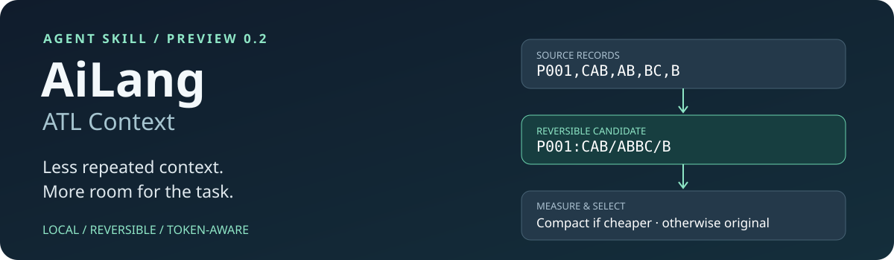

# AiLang — ATL Context

**Меньше повторяющегося контекста — больше места для задачи.**

Экспериментальный скилл для ИИ-агентов: сравнивает обратимые форматы представления независимых задач и выбирает более компактный только при подтверждённом снижении оценочного количества входных токенов.

[English](README.md) · [Установка](docs/INSTALL.md) · [Исследования](RESEARCH.md)

## Что умеет версия 0.2.0

- Группирует одинаковые исходные контексты, сохраняя порядок, ID и весь текст.
- Сравнивает плоский JSON, сгруппированный JSON, кортежи и строковый формат.
- Кодирует последовательности безусловных перестановок в CSV и компактной нотации ATL.
- Проверяет обратимость и словарь токенизатора. При ошибке сохраняет исходный формат.

Установка в Codex: скопировать целиком папку `skills/atl-context` в `.agents/skills/` проекта. Запустить новую сессию и вызвать `$atl-context`. Для измерений необходим локальный файл рангов o200k_base, инструкция — [здесь](docs/INSTALL.md).

## Результаты пилота

На 27 уникальных задачах с тремя повторами ATL получил 81/81 правильных ответов при 1 600 входных токенах на запуск против 18 440 для подробного английского и 2 672 для CSV. Экономия 91,32% и 40,12% соответственно. Это статические токены конкретных промптов, не стоимость использования скилла. Превосходство точности статистически не доказано, внутренние токены и время не измерялись.

[Данные эксперимента](lab/synthetic_benchmark_v3/results/summary.json). Скилл находится на стадии предварительной версии; интеграции с хостами ещё не проверены. Лицензия пока не выбрана.
